# Studio colori della griglia (T9 parte B)

Stato: **studio, nessun codice dell'app toccato.** Genna sceglie, poi si implementa.
Telefono 390×844, partita vera a due client (Semino verde = tu, Semina blu = Mati). Stesso momento di gioco in tutte le immagini: cambia solo il CSS.

Nelle immagini, in ogni griglia:
- il **mio cursore** è su un numero che ho scritto io, quindi tutti i numeri uguali sono "uguali";
- il **suo cursore** è su una cella vuota della mia colonna;
- due **errori**: uno nella mia riga, uno con la stessa cifra del cursore;
- celle scritte da me e da lei, una cella con le **note**.

## 1. Le immagini a confronto

### Scuro (sera)

**Oggi.** Riga, colonna e box quasi non si vedono. Il mio cursore è crema, non verde.
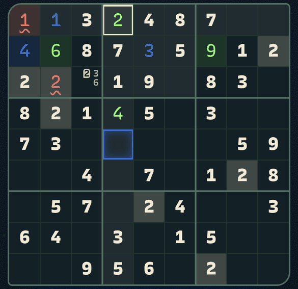

**A, anelli vivi.** Il mio cursore è un anello verde pieno e spesso. Il suo è un anello blu tratteggiato.
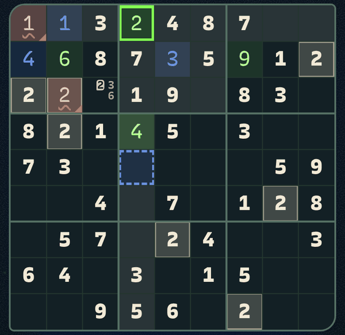

**B, due fasce di colore.** La mia riga/colonna/box è un velo verde, la sua un velo blu. Dove si incrociano diventa verde-azzurro.
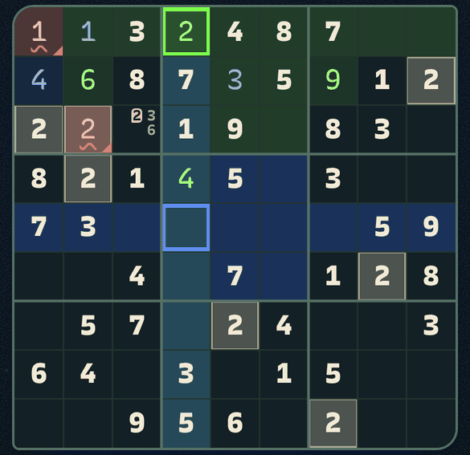

**C, celle piene.** Le due celle dei cursori sono piene: verde fluo la mia, blu elettrico la sua.
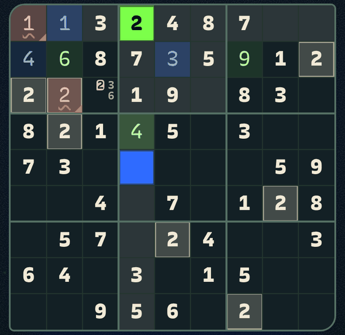

### Chiaro (mattina)

**Oggi.**
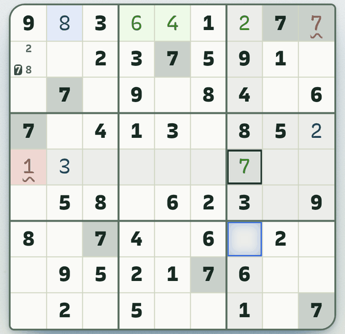

**A, anelli vivi.**
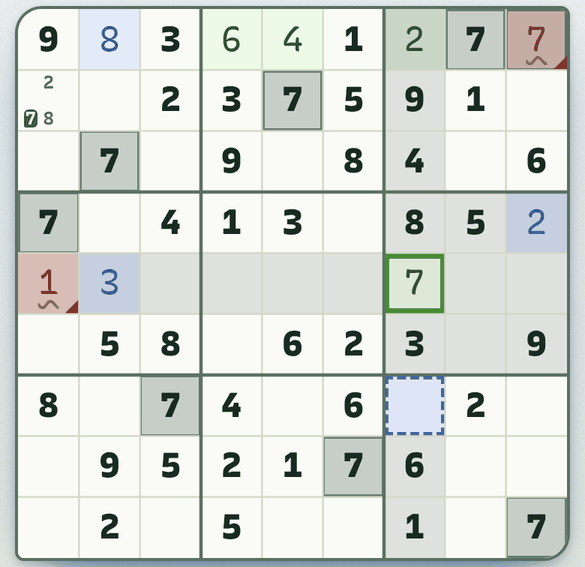

**B, due fasce di colore.**
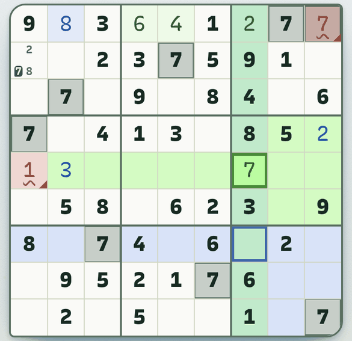

**C, celle piene.**
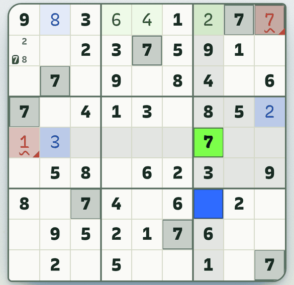

### Siamo sulla stessa cella (scuro)

Oggi il suo anello blu cancella il mio crema: sembra che io non abbia selezionato niente.

| Oggi | A |
|---|---|
| 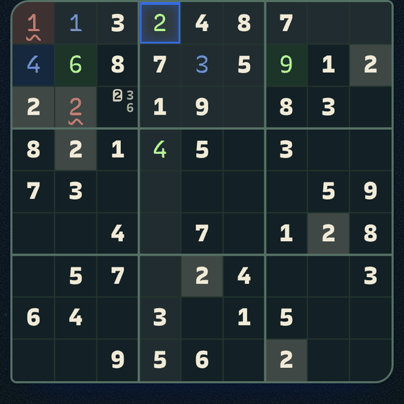 | 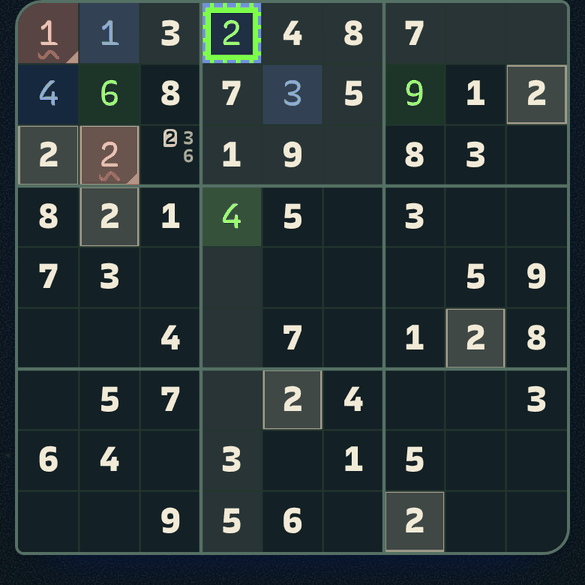 |

| B | C |
|---|---|
| 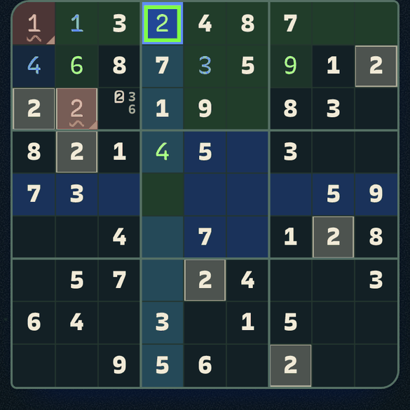 | 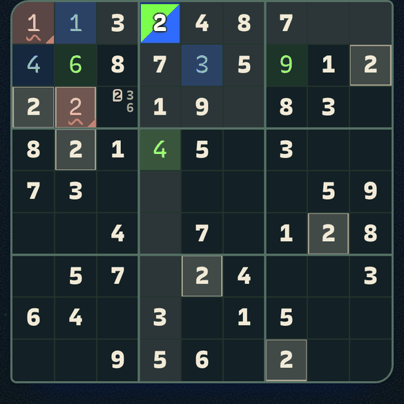 |

A: anello verde dentro, tratteggio blu fuori, si leggono tutti e due. B: verde dentro e blu fuori. C: cella divisa in diagonale.
Gli stessi scatti in chiaro: `img/t9-colori-sudoku-*-chiaro-insieme.png`.

### Schermate intere (sudoku)

Telefono intero, 390×844, nei due temi: `img/t9-colori-sudoku-{attuale,a-anelli,b-fasce,c-pieni}-{scuro,chiaro}.png`.
Killer: `img/t9-colori-killer-{...}-{scuro,chiaro}.png`.

## 2. Il problema, in poche righe

- Il colore di **fondo** di una cella dice una cosa sola, ma gli stati sono tanti.
- Quando due stati si sommano, **vince uno e l'altro sparisce** (il CSS cambia solo `--bg`).
- Riga/colonna/box è un grigio quasi uguale al fondo.
- Il mio cursore non ha il mio colore: è crema (al buio) o verde scurissimo (di giorno).
- Il suo cursore è un filo blu da 2,5 px. Sopra un numero uguale diventa debole.
- Se siamo sulla stessa cella, vedo solo il suo.

## 3. Inventario degli stati

### Stati di una cella (classi in `Griglia.tsx`, regole in `tema.css` righe ~1053-1140)

| Stato | Classe | Come si vede oggi |
|---|---|---|
| Vuota | `cella` | fondo `--carta` |
| Data (della partita) | `data` | numero crema pesante (850) |
| Scritta da me | `mia` | fondo +9% del mio colore, numero `--mio-testo` |
| Scritta da lei | `sua` | fondo +11% del suo colore, numero `--suo-testo` |
| Nota | `note` | cifre piccole 1-9, quella uguale alla selezione in rilievo |
| Riga/colonna/box del mio cursore | `vicina` | crema +6% |
| Stesso numero della mia selezione | `stessa` | crema +16% |
| Mia selezione | `selezionata` | crema +13% e anello crema 2,5 px |
| Cursore di lei | `partner` | anello blu 2,5 px + alone interno che respira |
| Errore | `errore` | fondo +18% rosso, numero rosso, ondina |
| Numero acceso col doppio tocco | `faro` | fondo oro +22% |
| Gabbia killer | `con-somma`, linee tratteggiate | somma in alto a sinistra |
| Effetti passeggeri | `fx-arrivo`, `fx-lampo`, `fx-evento` | lampo blu 1 s, onda, lampo oro |

### Chi vince quando si sommano (CSS di oggi)

- Il fondo si decide con l'ordine nel file: `mia` < `sua` < `vicina` < `errore` < `stessa` < `selezionata` < `faro`.
- Quindi: **`vicina`, `stessa`, `selezionata` cancellano il fondo di `mia`, `sua` ed `errore`.**
- `selezionata`, `stessa`, `vicina` si escludono tra loro (`else if` in `Griglia.tsx`).
- L'anello di `partner` è dichiarato dopo quello di `selezionata`: **lei vince su di me** sulla stessa cella.
- `data` non ha fondo suo: prende quello degli altri stati.

### Combinazioni realistiche, tutte nel "banco di prova"

Una cella per stato, sulla vera griglia. Nove celle per riga, da sinistra:

1. vuota, data, mia, sua, vicina, stessa, selezionata, partner, errore
2. mia+vicina, sua+vicina, mia+stessa, sua+stessa, data+stessa, mia+selezionata, sua+selezionata, errore+vicina, errore+stessa
3. errore+selezionata, partner+vicina, partner+stessa, partner+selezionata, partner+mia, partner+errore, faro, nota, data+vicina
4. (solo B) le stesse con la **sua** riga/colonna/box (`vicina-suo`)

| | Scuro | Chiaro |
|---|---|---|
| Oggi | 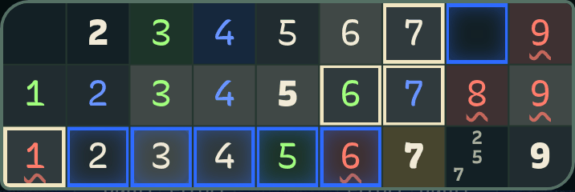 | 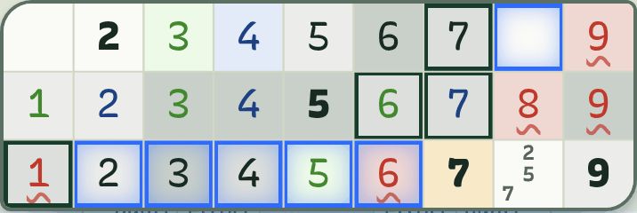 |
| A | 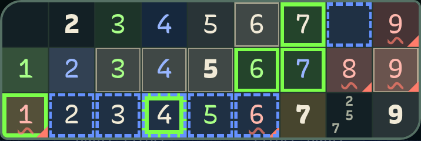 | 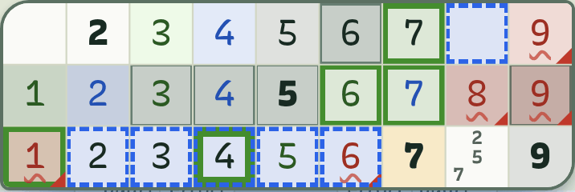 |
| B | 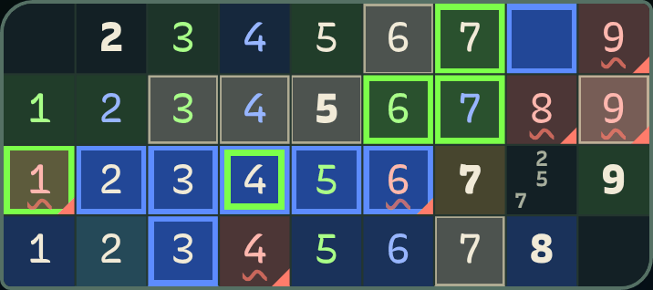 | 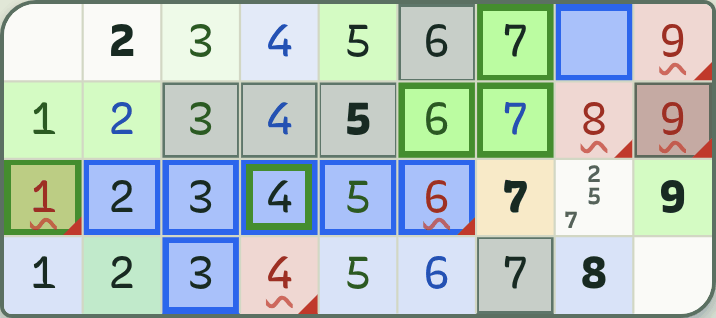 |
| C | 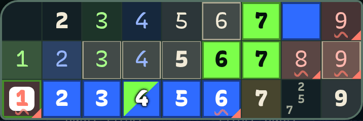 | 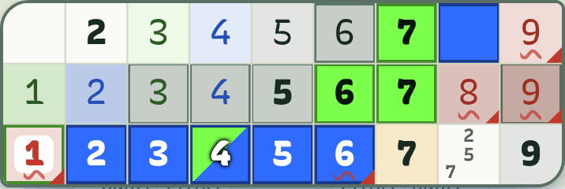 |

### Le 4 fasce del momento non cambiano la griglia

- `useMomento` arriva solo a Home, Giardino e Vittoria (la `Scena`). **`Partita.tsx` non lo riceve.**
- `data-momento` sta solo su `.sc-scena`. Le variabili `--sc-*` non toccano le celle.
- Quindi alba, giorno, crepuscolo e notte hanno **la stessa griglia**.
- Cambia solo chiaro/scuro: segue il sistema (`tema` automatico) o il tema forzato nel menù. Ho misurato i due.
- Misure fatte con il blu di coppia sbloccata (`--blu-presenza: 1`), come nel collaudo: con meno blu il fondo è un po' più verde.

## 4. Misure di oggi

Due modi di misurare:
- **ΔE** = differenza di colore (CIEDE2000). Sotto 3 non si distinguono. Tra 3 e 6 si distinguono con fatica, soprattutto al sole. Sopra 10 si vedono bene.
- **Contrasto** = WCAG, da 1 a 21. Per gli anelli e i bordi serve almeno 3:1. Per i numeri puntiamo a 4,5:1 (sono grandi, 3:1 è il minimo accettabile).

Tutti i valori sono letti dal browser sul CSS vero, non stimati.

### Dove due stati si confondono

| Coppia di stati vicini | Scuro | Chiaro | Esito |
|---|---|---|---|
| Riga/colonna/box vs cella vuota | ΔE **3,9** (1,16:1) | ΔE **2,8** (1,12:1) | si confondono |
| Riga/colonna/box vs mia selezione (fondo) | ΔE 4,6 | ΔE 3,4 | si confondono, salva solo l'anello |
| Numero uguale vs mia selezione (fondo) | ΔE 5,6 | ΔE 4,4 | deboli |
| Mia o sua dentro la riga evidenziata vs riga vuota | ΔE **0** | ΔE **0** | il tinto sparisce |
| Errore sotto numero uguale o selezione vs senza errore | ΔE **0** | ΔE **0** | il fondo rosso sparisce |
| Mia selezione + suo cursore sulla stessa cella vs solo suo | anello mio perso | anello mio perso | il mio non si vede |
| Anello di lei vs numero uguale accanto | **2,09:1** | 2,86:1 | sotto 3:1 |
| Anello di lei vs riga evidenziata | 3,18:1 | 3,83:1 | al limite |
| Anello mio (crema) vs anello suo (blu), luminosità | 3,61:1 | 2,71:1 | distinti solo per tinta |
| Numero suo su "numero uguale" | 3,3:1 | 6,2:1 | scuro sotto 4,5 |
| Numero mio su "numero uguale" | 7,7:1 | **2,8:1** | chiaro sotto 3 |
| Numero mio su mia selezione | 9,5:1 | 3,3:1 | chiaro debole |
| Errore su "numero uguale" | 3,7:1 | 3,5:1 | sotto 4,5 |

**Il peggiore: ΔE 0.** Per sei coppie non c'è nessuna differenza di fondo, perché il CSS ne fa vincere uno solo.
Poi: ΔE 2,8 (riga vs vuota, chiaro), 2,09:1 (anello di lei su numero uguale, scuro), 2,8:1 (mio numero su numero uguale, chiaro).

Cosa va bene già oggi: mia vs sua come fondo (ΔE 19,8 / 15,6), errore vs vuota (17 / 12), numero uguale vs vuota (13,7 / 10,4), anello crema vs fondo (9:1).

## 5. Le proposte

Tutte tengono **verde per lui e blu per lei**. I ruoli si scambiano da soli: sul telefono di Mati il suo colore è `--mio`.
Tutte spostano l'errore su un **triangolino rosso nell'angolo in basso a destra** (non copre la somma del killer, in alto a sinistra) e mantengono il fondo rosso sotto riga, uguale e selezione.
Tutte schiariscono i numeri nei colori dei giocatori per i contrasti. Il CSS completo è in `scripts/qa/colori-griglia-proposte.mjs`.

Riepilogo misurato (scuro / chiaro):

| | Oggi | A | B | C |
|---|---|---|---|---|
| Riga/colonna/box vs vuota (ΔE) | 3,9 / 2,8 | **6,5 / 5,5** | 17,0 / 19,7 | 7,2 / 4,6 |
| Numero uguale vs riga (ΔE) | 9,9 / 7,7 | 7,3 / 5,6 | 14,7 / 18,6 | 7,3 / 6,4 |
| Coppie con ΔE 0 | 6 | **1** | 3 | 1 |
| Anello di lei vs sfondi vicini (min) | 2,09 / 2,86 | **4,5 / 4,1** | 2,8 / 2,8 | cella piena |
| Peggior numero su sfondo | 3,3 / 2,8 | **4,2 / 3,5** | 3,6 / 3,4 | 4,0 / 3,4 |
| Cambia la regola "mai a blocchi" | no | **no** | **sì** | **sì** (2 celle) |
| Codice oltre il CSS | no | no | 1 riga in `Griglia.tsx` | no |

### A. Anelli vivi (regola intatta)

Verde e blu solo in anelli e numeri. Nessun blocco di colore.

- **Mia selezione**: anello **pieno, 3,5 px, nel mio colore** vivo, fondo appena tinto.
- **Suo cursore**: anello **tratteggiato, 3 px, nel suo colore**, fondo appena tinto.
- **Insieme sulla stessa cella**: verde pieno dentro (6,5 px), tratteggio blu fuori.
- **Riga/colonna/box**: grigio più marcato.
- **Numero uguale**: grigio più chiaro con **filo crema** da 1,5 px.
- **Errore**: fondo rosso (22%) che resta sotto qualsiasi stato, triangolino, numero rosso più chiaro.
- **Mia o sua dentro la riga**: il tinto del giocatore resta (14%).

Variabili (scuro, di base):
```css
.app {
  --g-mio: var(--mio);                                   /* #7cff4a */
  --g-suo: color-mix(in srgb, var(--suo) 74%, #fff);     /* #6591ff */
  --g-vicina: color-mix(in srgb, var(--inchiostro) 10%, var(--carta));
  --g-uguale: color-mix(in srgb, var(--evid) 16%, var(--carta-2));
  --g-filo-uguale: color-mix(in srgb, var(--evid) 55%, transparent);
  --g-sel: color-mix(in srgb, var(--g-mio) 16%, var(--carta));
  --g-errore: color-mix(in srgb, var(--errore) 22%, var(--carta));
  --g-errore-testo: color-mix(in srgb, var(--errore) 55%, #fff);
  --g-testo-mio: color-mix(in srgb, var(--mio) 66%, #fff);
  --g-testo-suo: color-mix(in srgb, var(--suo) 50%, #fff);
}
```
Chiaro (stesso schema di `tema.css`: `@media (prefers-color-scheme: light)` e `[data-tema='chiaro']`):
```css
  --g-mio: color-mix(in srgb, var(--mio) 50%, #0c1a12);  /* #448c2e */
  --g-suo: color-mix(in srgb, var(--suo) 90%, #0c1a12);  /* #2b63e7 */
  --g-errore: color-mix(in srgb, var(--errore) 16%, var(--carta));
  --g-errore-testo: color-mix(in srgb, var(--errore) 82%, #000);
  --g-vicina: color-mix(in srgb, var(--inchiostro) 12%, var(--carta));
  --g-uguale: color-mix(in srgb, var(--evid) 17%, var(--carta-2));
  --g-testo-mio: color-mix(in srgb, var(--mio) 28%, #0c1a12);
  --g-testo-suo: color-mix(in srgb, var(--suo) 68%, #0c1a12);
```
Regole chiave:
```css
.cella.selezionata { --bg: var(--g-sel); box-shadow: inset 0 0 0 3.5px var(--g-mio); }
.cella.partner { --bg: color-mix(in srgb, var(--g-suo) 14%, var(--carta)); box-shadow: none; }
.cella.partner::after { box-shadow: none; border: 3px dashed var(--g-suo); animation: none; }
.cella.partner.selezionata { box-shadow: inset 0 0 0 6.5px var(--g-mio); }
.cella.stessa { --bg: var(--g-uguale); box-shadow: inset 0 0 0 1.5px var(--g-filo-uguale); }
.cella.errore::before { /* triangolo 10 px in basso a destra, var(--errore) */ }
```

Misure A (scuro / chiaro):
- riga vs vuota: ΔE 6,5 / 5,5
- anello mio vs sfondi vicini: 8,4:1 e più / 3,2:1 e più
- anello suo vs sfondi vicini: 4,5:1 / 4,1:1
- numero su sfondo, il peggiore: errore su numero uguale 4,2:1 / 3,5:1
- mio e suo numero su "numero uguale": 7,8 e 4,6 / 5,1 e 4,5

Pro:
- **Non tocca la regola dei colori**: verde e blu restano nei dettagli.
- Risolve tutte le confusioni di oggi. Resta un solo ΔE 0: il tinto "mia" sotto il fondo di selezione, dove c'è l'anello.
- Il mio cursore finalmente è **verde per Genna e blu per Mati**.
- Il suo è riconoscibile anche in bianco e nero: **tratteggiato**, il mio pieno.

Contro:
- Ai 390 px il tratteggio da 3 px è piccolo.
- **Killer**: le gabbie sono tratteggiate. Il tratteggio blu del partner può somigliare a una gabbia. Differiscono per colore (blu vivo contro crema 50%) e spessore. Da guardare dal vero, con l'alternativa di un anello pieno più sottile solo nel killer.
- Di giorno i due anelli sono scuri entrambi (verde 3,2-4,0:1, blu 4,1-5,0:1 sui fondi vicini): per luminosità si somigliano (1,25:1), si leggono per tinta e per tratto.
- Non mostra la riga/colonna del partner.

### B. Due fasce di colore (rivede la regola)

Chi gioca ha la **sua zona colorata**: velo verde sulla mia, velo blu sulla sua, verde-azzurro dove si incrociano.

- **Mia riga/colonna/box**: velo verde 13% (scuro) o 30% (chiaro).
- **Sua riga/colonna/box**: velo blu 24% (scuro) o 16% (chiaro).
- **Mia selezione**: velo verde forte + anello verde pieno 3,5 px.
- **Suo cursore**: velo blu forte + anello blu pieno 3,5 px.
- **Insieme**: anello verde dentro, blu fuori.
- **Numero uguale**: grigio più chiaro con filo crema.
- **Errore**: come in A, con tinto rosso 24% / 18%.

Variabili (scuro):
```css
.app {
  --g-mio: var(--mio);
  --g-suo: color-mix(in srgb, var(--suo) 78%, #fff);
  --g-velo-mio: color-mix(in srgb, var(--mio) 13%, var(--carta));            /* #213d2a */
  --g-velo-suo: color-mix(in srgb, var(--suo) 24%, var(--carta));            /* #1a325a */
  --g-velo-due: color-mix(in srgb, var(--mio) 11%, color-mix(in srgb, var(--suo) 24%, var(--carta)));
  --g-uguale: color-mix(in srgb, var(--evid) 22%, var(--carta-2));
  --g-sel: color-mix(in srgb, var(--mio) 22%, var(--carta));
  --g-part: color-mix(in srgb, var(--suo) 52%, var(--carta));                /* #224797 */
  --g-errore: color-mix(in srgb, var(--errore) 24%, var(--carta));
  --g-errore-testo: color-mix(in srgb, var(--errore) 55%, #fff);
  --g-testo-mio: color-mix(in srgb, var(--mio) 66%, #fff);
  --g-testo-suo: color-mix(in srgb, var(--suo) 50%, #fff);
}
```
Chiaro: `--g-velo-mio` 30% (#d4fbc3), `--g-velo-suo` 16% (#d9e3f8), `--g-sel` 50% (#bbfca1), `--g-part` 40% (#a9c1fa); anelli e testi come in A. Valori esatti nel file.

**Serve una riga in `Griglia.tsx`**: una classe `vicina-suo` per le celle nella riga, colonna e box del cursore del partner (oggi il partner ha solo la sua cella). Nel mio scatto l'ho aggiunta a mano dallo script.

Misure B (scuro / chiaro):
- riga vs vuota: ΔE 17,0 / 19,7 (molto netta)
- numero uguale vs riga: ΔE 14,7 / 18,6
- anello suo vs **mia** fascia verde: 2,8:1 / 2,8:1 (sotto 3). Vs la sua fascia blu: 4,0:1 / 3,9:1
- numero su sfondo, il peggiore: errore su numero uguale 3,6:1 / 3,4:1
- mia e sua dentro la fascia: ΔE 0 (conta solo il colore del numero)

Pro:
- **È la più vivace.** Si capisce subito di chi è ogni zona, anche a un'occhiata.
- Mostra anche dove sta guardando lei.
- Dove le zone si incrociano si legge il "noi" (verde-azzurro).

Contro:
- **Rivede la regola "verde e blu solo nei dettagli, mai a blocchi"**: un velo verde e uno blu su 25 celle. Serve l'**approvazione di Genna**.
- Con tanti numeri il velo pesa: i numeri scritti da me o da lei dentro la zona perdono il loro tinto di fondo.
- Il blu di lei, di giorno, è un blocco azzurro grande. Le due fasce insieme sono molto colore.
- Una riga in più di codice, in un file di contratto della UI.
- Il blu forte vicino al verde stanca dopo una partita lunga (da provare dal vero).

### C. Celle piene (rivede la regola, in piccolo)

Solo le **due celle dei cursori** sono piene del colore vivo. Il resto resta neutro.

- **Mia selezione**: cella piena di `--mio` (verde fluo), numero scuro in 850. Filo scuro da 2 px.
- **Suo cursore**: cella piena di `--suo` (blu elettrico), numero bianco in 850.
- **Insieme**: cella divisa in diagonale verde/blu.
- **Riga/colonna/box**: grigio un po' più marcato (11%).
- **Numero uguale e errore**: come in A.

Variabili: come A, con
```css
--g-sel: var(--mio);   --g-part: var(--suo);
--g-sel-testo: #06140c;   --g-part-testo: #ffffff;
--g-vicina: color-mix(in srgb, var(--inchiostro) 11%, var(--carta));   /* scuro; chiaro 10% */
```

Misure C (scuro / chiaro):
- cella piena vs riga evidenziata: ΔE 71,7 / 29,6; contrasto 9,6:1 / **1,02:1**
- riga vs vuota: ΔE 7,2 / 4,6
- numero sulla mia cella piena: 14,6:1 (scuro su verde); sulla sua: bianco su blu, circa 4,5:1
- cella blu piena vs fondo vuoto: 3,7:1 / 4,3:1
- numero su sfondo, il peggiore: errore su numero uguale 4,0:1 / 3,4:1

Pro:
- **Il cursore si trova al volo**, anche al sole o con la griglia piena.
- Pochissimo colore: solo due celle alla volta.
- Nessun codice oltre il CSS.

Contro:
- **Rivede la regola dei blocchi** per due celle. Serve l'approvazione di Genna.
- Di giorno il verde fluo pieno ha la stessa luminosità del fondo (1,02:1): si vede per la tinta, non per la luce. Chi non distingue bene il verde lo perde. Per questo il filo scuro da 2 px.
- La cella verde piena copre il tinto "mio" e ogni stato sotto: un errore selezionato richiede una pastiglia bianca (nello scatto si vede).
- Non mostra la zona (riga/colonna/box) con i colori dei giocatori.
- Il cursore verde acceso su una cella già scritta da me ne nasconde il verde.

## 6. Raccomandazione

**Scelgo A.** Poi, se vuoi più vivacità, aggiungi alla A la zona del partner di B in versione leggera (da valutare dopo averla vista dal vero).

Perché:
1. Risolve ogni confusione misurata: da 6 coppie con ΔE 0 a 1, riga vs vuota da ΔE 2,8/3,9 a 5,5/6,5, anello di lei sopra 4,1:1.
2. **Non rivede la regola.** Verde e blu restano nei dettagli, come l'hai approvata il 3/11.
3. Il tuo cursore è **verde**, quello di Mati **blu**: ora si legge a prima vista chi è chi.
4. Il tratteggio dice "è suo" anche senza guardare il colore.
5. Non cambia `Griglia.tsx`: solo `tema.css`.

Da guardare dal vero prima di approvare:
- Il tratteggio blu nel killer, accanto alle gabbie.
- Il mattino al sole: l'anello verde scuro (3,3:1 sul fondo) è il valore più debole di A.
- L'errore sul numero uguale (3,5:1 di giorno) e le note.

**Decisioni per Genna**
- Quale proposta: A, B o C.
- Se B o C: approvare la modifica della regola "mai a blocchi" per la griglia.
- Se B: va bene una riga in `Griglia.tsx`.

Dopo la scelta si aggiorna `docs/design/studio-ui.md` (la regola cambia solo se approvi B o C) e si porta il CSS scelto in `tema.css`.

## 7. Come ho misurato

- Script: `scripts/qa/colori-griglia.mjs` (cattura e misura), `scripts/qa/colori-griglia-proposte.mjs` (CSS delle proposte, iniettato con `page.addStyleTag`), `scripts/qa/colori-griglia-analisi.mjs` (WCAG e CIEDE2000), `scripts/qa/colori-griglia-immagini.py` (peso delle immagini).
- Due client Playwright 390×844 a 2x, peerjs locale su 9100 e vite su 5273, stessa frase, Semino e Semina. L'app non è stata modificata.
- Per ogni variante e tema il browser dà il colore calcolato di sfondo, numero e anello di 36 combinazioni di classi su una cella vera (anche quelle che l'app non produce, per il banco di prova).
- Colori letti con un canvas, quindi sRGB a 8 bit come li vede lo schermo. Animazioni e transizioni spente durante la misura.
- Tema chiaro e scuro con `colorScheme` del browser. `--blu-presenza` forzata a 1.
- Soglie: ΔE sotto 3 = indistinguibili, 3-6 = deboli, oltre 10 = netti; WCAG 3:1 per anelli e contorni, 4,5:1 per i numeri.
- Limite: ho misurato lo stato fermo. Il lampo blu delle mosse del partner (1 s) e l'onda di riga completata non sono nell'analisi.
- Nel killer non ho misurato: ho solo guardato gli scatti (`t9-colori-killer-*`).

## 8. Realizzata (12/11)

Scelta di Genna: B con le modifiche della spec `docs/specs/T9-B-colori.md` (ADR 007). Solo CSS (`src/ui/tema.css`, blocco "Stati della griglia"); `Griglia.tsx` non cambia.
Scatti: partita vera a due client, 390×844, `scripts/qa/colori-griglia-t9b.mjs` (poi `python3 -I scripts/qa/colori-griglia-immagini.py t9b`). Genna è su un numero che ha scritto (i numeri uguali si accendono), Mati su una casella lontana; numeri di tutti e due, un errore di Genna nella sua fascia, note.

### Sudoku

| | Schermo di Genna | Schermo di Mati |
|---|---|---|
| Scuro | 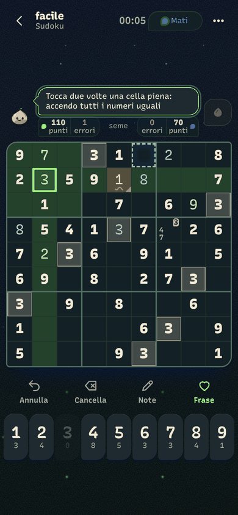 | 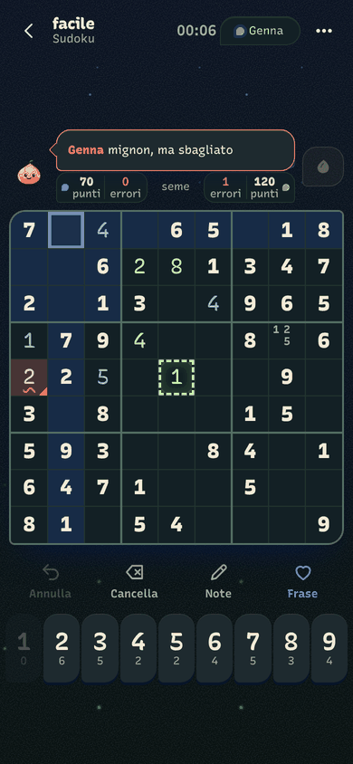 |
| Chiaro | 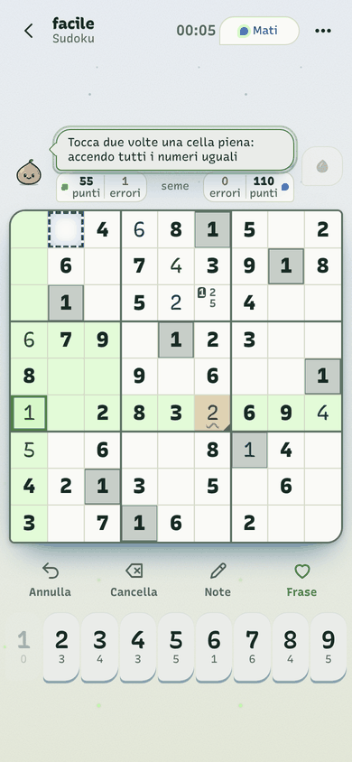 | 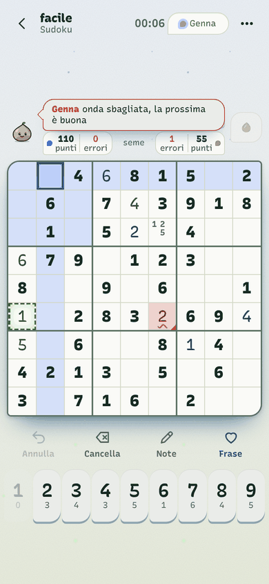 |

Sul telefono di Mati "mio" è il blu: la fascia è blu, i suoi numeri sono blu, quelli di Genna verdi, e Genna è il tratteggio verde.

### Sulla stessa casella

Mati va sulla casella di Genna: anello pieno di chi guarda dentro, tratteggio dell'altro fuori.

| | Genna | Mati |
|---|---|---|
| Scuro | 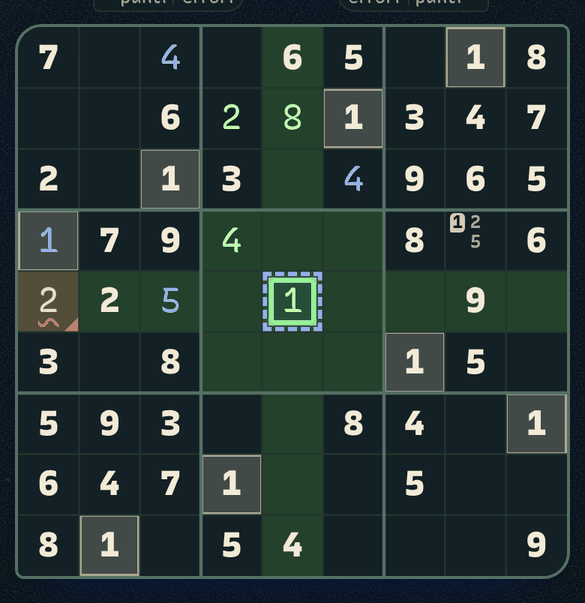 | 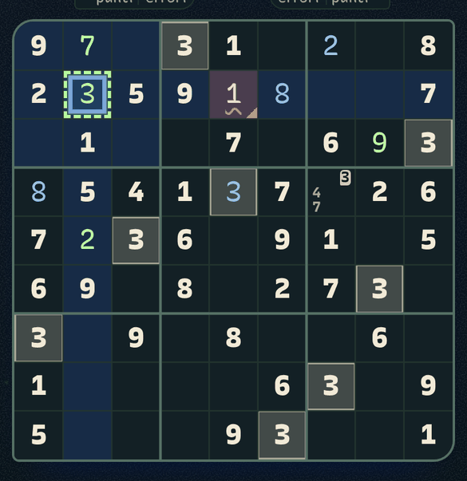 |
| Chiaro | 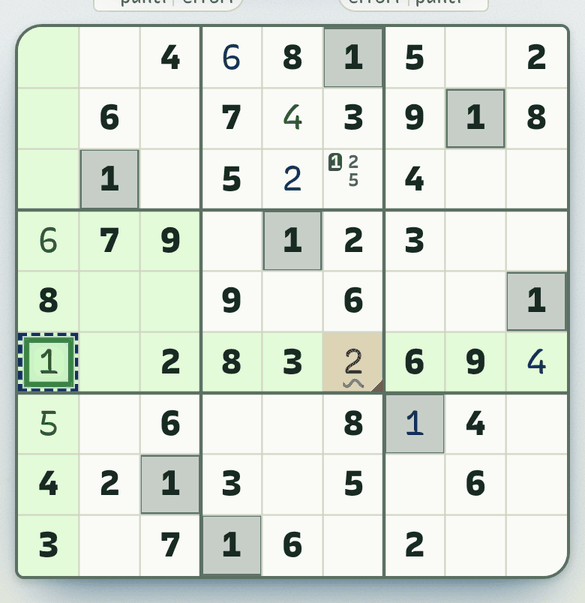 | 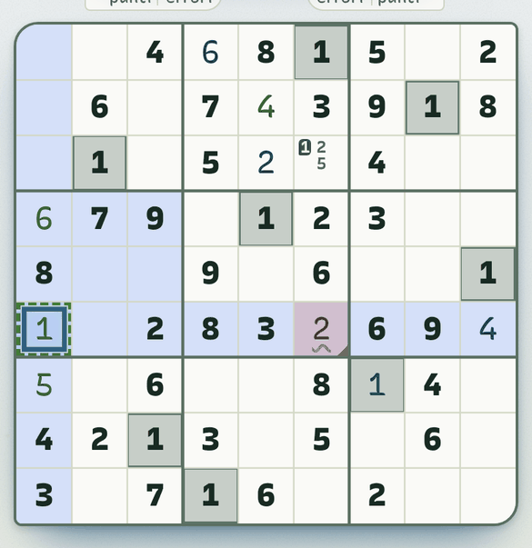 |

### Killer

| | Genna | Mati |
|---|---|---|
| Scuro | 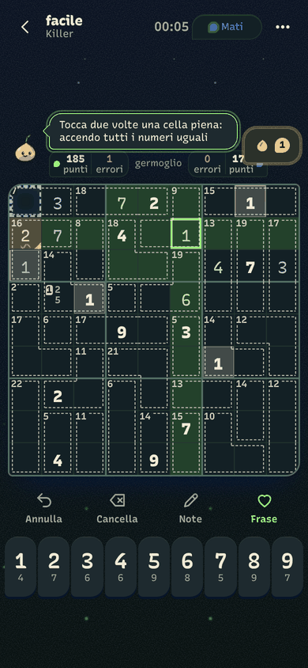 | 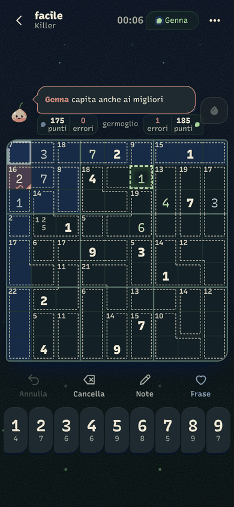 |
| Chiaro | 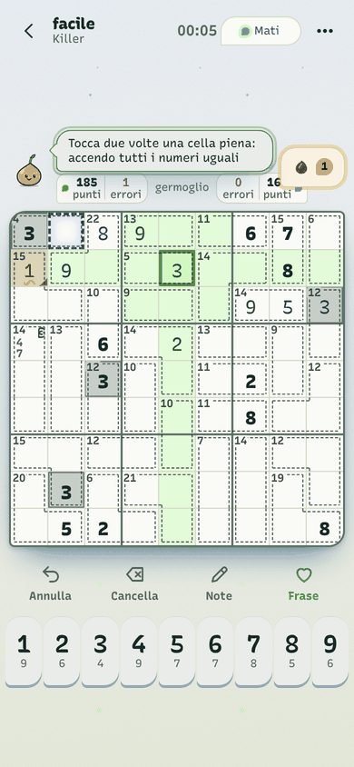 | 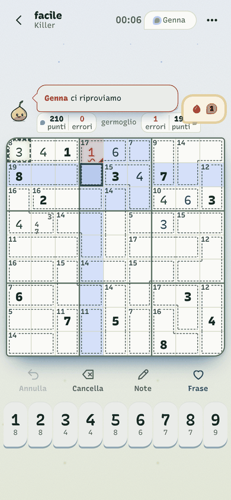 |

### Contrasti misurati (minimo su tutte le combinazioni, sudoku e killer, Genna e Mati)

Misure nel browser sul CSS vero, `--blu-presenza` 1 (con 0 le soglie restano rispettate: fascia ΔE 14,0 / 14,0, numeri 4,70 / 4,63). Combinazioni: 8 fondi (vuota, fascia, selezione, uguale, faro e faro sopra gli altri tre) × numero dato, mio, suo, errore mio, errore suo; più il partner su ognuno.

| Soglia della spec | Scuro | Chiaro | Dove è il minimo |
|---|---|---|---|
| Numeri ≥ 4,5:1 su ogni fondo | **4,78** | **4,62** | scuro: numero blu su "uguale"; chiaro: errore su "uguale"+errore |
| Tratteggio del partner ≥ 3:1 su carta | **7,64** | **5,02** | chiaro: tratteggio verde (schermo di Mati) |
| Tratteggio del partner ≥ 3:1 sulla mia fascia | **5,17** | **3,96** | scuro: blu su fascia verde; chiaro: verde su fascia blu |
| Fascia vs casella vuota ΔE ≥ 10 | **11,98** | **13,34** | fascia blu di Mati (la verde: 18,6 / 14,9) |
| Numero mio vs suo ΔE ≥ 20 | **47,8** | **41,7** | luminosità diverse: 1,65:1 / 1,70:1 |

Altre misure (nessuna soglia nella spec):
- numero uguale e faro rispetto alla fascia: ΔE 13,7 e 11,9 (scuro) / 14,5 e 14,8 (chiaro) o più;
- errore rispetto allo stesso fondo senza errore: ΔE 13,1 (scuro, sulla selezione) / 10,9 (chiaro, sul faro) o più; il triangolino c'è su tutti i fondi;
- mio anello sulla mia selezione: 7,6 / 3,65 (Genna), 4,7 / 6,2 (Mati);
- stessa casella, tratteggio del partner sul mio fondo di selezione: 4,3 / 9,4 (Genna), 11,2 / 3,4 (Mati);
- killer: somma della gabbia ≥ 4,65 / 5,41 su ogni fondo, anche con l'errore; linea della gabbia ≥ 5,37 / 5,47;
- note nella fascia: 4,9 / 4,8 o più.

Sotto 3:1 restano solo casi fuori dalla spec: di giorno, sul telefono di Mati, il tratteggio verde di Genna sopra una casella con errore che è anche uguale o selezionata (2,54 e 2,59; al buio il minimo è 3,16) e, nello scuro di Mati, la selezione blu rispetto alla fascia blu (ΔE 2,9: si distingue per l'anello, 4,7:1).

### Differenze rispetto alla proposta B
- **Niente fascia del partner** (`vicina-suo`) né velo misto: del partner solo il tratteggio da 3 px (B: velo blu forte e anello pieno). Nessuna riga in `Griglia.tsx`.
- **Il fondo si compone**: `--fondo` (carta < fascia < uguale < selezione < faro) e sopra il rosso dell'errore (22% scuro, 20% chiaro). In B la fascia e il numero uguale sostituivano ancora il fondo.
- **Caselle `mia`/`sua` senza fondo** anche fuori dalla fascia; chi ha scritto lo dice solo il numero.
- **Le tinte sono le stesse per i due ruoli** (`color-mix` su `--mio`/`--suo`), quindi tarate sul colore più difficile: velo 15% / 18% (B 13% / 30%: col blu di Mati il 30% di giorno è un blocco blu), selezione 21% / 30% (B 22% / 50%), numeri 46% + bianco / 30% + #0c1a12 (B li tarava diversi per verde e blu).
- **Mio anello** schiarito al buio (`--mio` 70% + bianco): il blu puro di Mati sul suo velo era sotto 3:1.
- **Tratteggio**: scuro 55% + bianco, chiaro 42% + #0c1a12; basta la tinta, senza filo sotto.
- **Respiro**: l'alone resta e respira, ma sta dentro il tratteggio (3 px) e più tenue (35%, era 55%), così non lo sbiadisce. Il tratteggio non respira: resta sempre sopra 3:1.
- **Triangolino dell'errore** come immagine di sfondo (B usava `::before`, che ora è il tratteggio).
- Variabili nuove della griglia (`--g-*`); `--mio-testo`/`--suo-testo` restano per il resto dell'app.
