# Studio UI (Traguardo 3)

Obiettivo: un'interfaccia che sembri fatta per Genna e Mati, non uscita da un modello. Immagini in `img/`: a sinistra **prima** (T2b), a destra **dopo** (T3), telefono 390×844 tema notte salvo dove indicato.

## 1. Ricerca (sintesi)

- **I segni del "fatto dall'IA"** ([impeccable.style/slop](https://impeccable.style/slop), [superdesign](https://www.superdesign.dev/blog/why-ai-design-looks-generic)): testo in gradiente, neon su fondo scuro, griglie di card tutte uguali, bordo sottile più ombra larga e grigia, sfondi a reticolo decorativo, pallini che pulsano senza che cambi niente, spaziatura uguale ovunque, font di sistema (Inter) dappertutto. Rimedio: un solo colore pieno per i testi, enfasi con peso e dimensione, raggruppare con la spaziatura, card solo dove servono.
- **Tipografia con carattere** ([recursive.design](https://recursive.design/), [Google Fonts, variabili](https://fonts.google.com/knowledge/using_type/styling_type_on_the_web_with_variable_fonts)): un'unica famiglia variabile basta se la gerarchia si fa con peso, dimensione e un asse espressivo. Recursive ha l'asse *Casual* (CASL): lineare per i dati, "a pennarello" per la voce delle mascotte.
- **Ritmo** ([imperavi, vertical rhythm](https://imperavi.com/books/ui-typography/principles/vertical-rhythm/)): scala di spazi su multipli di 4/8, poco spazio tra cose legate e molto tra gruppi.
- **Colore al buio** ([atmos.style](https://atmos.style/blog/dark-mode-ui-best-practices)): fondi non neri ma tinti, superfici più chiare per alzarle, accenti saturi solo in piccole dosi e mai come testo lungo.
- **Game feel / juice** ([GameAnalytics](https://www.gameanalytics.com/blog/squeezing-more-juice-out-of-your-game-design)): easing con inerzia (ease-out per ciò che arriva), piccole pause d'impatto, squash and stretch; **più un'azione è frequente, più il suo juice dev'essere semplice**. Da qui: tasto e numero con risposta fisica e breve (≤ 300 ms), il momento grande solo alla vittoria.

## 2. Audit onesto delle schermate T2b

| Dove | Cosa sapeva di generato | Perché |
|---|---|---|
| Titoli "Sudoku di coppia", "medio", "Giardino" | testo in gradiente verde→blu | è il segno più riconoscibile del genere; per di più il gradiente spezzava le lettere a metà |
| Bottone "Nuova partita" | gradiente 50/50 verde/blu a tutta larghezza | bicolore spiattellato sull'elemento più grande della schermata: urlava più della griglia |
| Livello scelto | bordo a gradiente | stesso tic del bicolore, su un controllo che dovrebbe dire solo "scelto da te" |
| Sfondo | reticolo di puntini (5/7/13 px) | "griglia decorativa": si vede come trama, non come grana |
| Toast in partita | frasi in corsivo nero sopra le celle, banner che copre il cruscotto, frase del partner a schermo intero | coprivano proprio ciò su cui si gioca (vedi `img/4-partita-telefono-errore.jpg`, a sinistra) |
| Font | Recursive caricato da Google Fonts, nei test e offline cadeva su Inter/sistema | metà dell'identità spariva senza rete |
| Pesi | 11 pesi diversi (480…900) | gerarchia piatta e rumorosa |
| Giardino | 3 card di totali + una card per pianta, tutte uguali | "identical card grid" |
| Superfici | bordo sottile + ombra grigia larga | ogni superficie diceva la stessa cosa allo stesso volume |
| Animazioni | fino a 1,3 s (arrivo, lampo d'oro), vittoria a 0,75 s con rimbalzo | reazioni lente per gesti frequenti |

## 3. Colori

### Vincoli
Verde fluo `#7CFF4A` (Genna) e blu elettrico `#2F6BFF` (Mati) restano. Pesano in modo molto diverso: sul fondo il verde fa 14:1, il blu 4:1. Il blu come testo non arriva mai a 4,5:1 su un fondo tinto (serve una variante chiara `--blu-testo #8AA9FF`, 8:1); come bordo supera 3:1. Conseguenza: per pesare uguale, il verde va dato in **punti e fili sottili**, il blu in **aloni, ombre e stelle** (più area, meno luminanza).

### Tre candidate
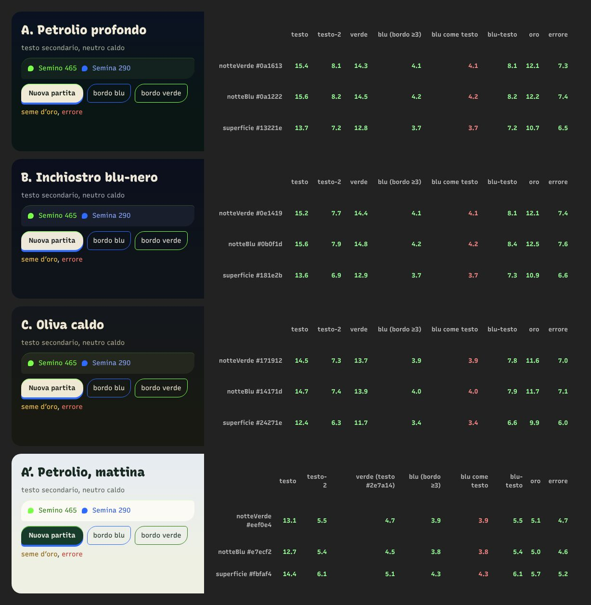

Pagina di prova: `docs/design/colori-prova.html` (generata dallo script di studio). Soglie: crema ≥ 7:1, testo secondario e accenti come testo ≥ 4,5:1, bordi ≥ 3:1. Valori sul fondo verde / fondo blu / superficie:

| Candidata | crema | testo-2 | verde | blu bordo | blu-testo | esito |
|---|---|---|---|---|---|---|
| A. Petrolio profondo `#0A1613` / `#0A1222`, sup. `#13221E` | 15,4 / 15,6 / 13,7 | 8,1 / 8,2 / 7,2 | 14,3 / 14,5 / 12,8 | 4,1 / 4,2 / 3,7 | 8,1 / 8,2 / 7,2 | tutto passa |
| B. Inchiostro blu-nero `#0E1419` / `#0B0F1D`, sup. `#181E2B` | 15,2 / 15,6 / 13,6 | 7,7 / 7,9 / 6,9 | 14,4 / 14,8 / 12,9 | 4,1 / 4,2 / 3,7 | 8,1 / 8,4 / 7,3 | passa, ma il blu sparisce nel blu |
| C. Oliva caldo `#171912` / `#14171D`, sup. `#24271E` | 14,5 / 14,7 / 12,4 | 7,3 / 7,4 / 6,3 | 13,7 / 13,9 / 11,7 | 3,9 / 4,0 / 3,4 | 7,8 / 7,9 / 6,6 | passa al limite, il verde fluo diventa acido sul giallo |

**Scelta: A, petrolio.** La sua tinta (fra 170° e 220°) sta a metà strada fra il verde (≈105°) e il blu (≈225°): nessuno dei due accenti è il complementare del fondo, quindi non vibrano e non si coprono. B fa sparire il blu (stessa tinta del fondo) e fa vibrare il verde; C spegne il blu e ingiallisce il verde, e ha i contrasti più bassi.

### Come vive in `tema.css`
- Base: `--notte-verde`, `--notte-blu`, `--terra`, `--superficie-verde/-blu`, `--testo` (crema `#F1EAD7`), `--testo-2` (salvia calda `#A7AE9C`), `--verde`, `--blu`, `--oro`, `--errore` (+ `--verde-testo`, `--blu-testo`, `--oro-testo`).
- Derivati dalla presenza (`--blu-presenza`, 0…1): `--fondo` = verde→blu al 55%, `--cielo` (alto dello schermo) fino al 100%, `--fondo-2` (terra, in basso) resta verde (12% di blu), `--superficie` al 45%, `--ombra-tinta` dal nero al blu al 40%.
- Sfondo: un gradiente ampio cielo→fondo→terra, grana vera (rumore frattale SVG), **stelle blu** nella metà alta (si accendono con la presenza) e **lucciole verdi** nella metà bassa. Nessun blocco di colore.
- Dettagli prima dello sblocco (presenza < 1): verde nel filo di luce delle superfici, nelle lucciole, nel seme del titolo, nel filo alto della barra; il blu entra piano (stelle, ombre, gradino del bottone, seme vuoto che si riempie). Dopo: metà e metà ma **distribuito**: ogni elemento ha un solo colore per parte (luce verde in alto, ombra blu in basso; seme verde e seme blu separati; pallino col colore di lei dentro e di lui come alone).
- **Mattina** (tema chiaro): stessa logica su `#EEF0E4` / `#E7ECF2`, superficie `#FBFAF4`, testo `#182A22` (13:1). Il verde fluo come testo su chiaro fa 1,1:1: resta solo riempimento, scritte e fili usano `#2E7A14` (4,7:1); blu-testo `#2453D6` (5,5:1). Testi nei colori dei giocatori: 72% verso il bianco al buio (blu 5:1), 48% verso l'inchiostro di mattina (verde 4:1, numeri della griglia = testo grande).

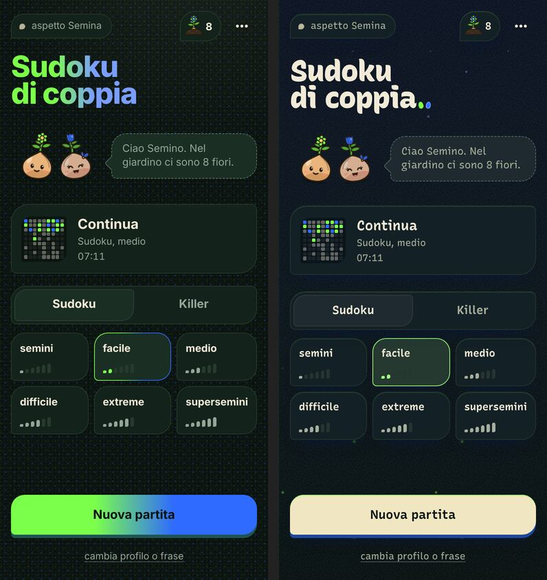

## 4. Scelte (una riga ciascuna)

- **Titoli**: crema, monocromi; l'unico dettaglio sono due semi al posto del punto: verde sempre, blu assente a 0 fiori, poi vuoto e via via pieno.
- **Bottone primario**: luna piena (crema), filo verde 1,5 px in alto, gradino d'ombra che passa da verde scuro a blu con la presenza.
- **Livello scelto**: bordo e tacche nel colore di chi gioca (`--mio-testo`), fondo appena tinto.
- **Pallino connessi**: dentro il colore del partner, alone del mio.
- **Barra di crescita**: quote personali invariate; filo verde sopra, filo blu sotto (si accende con la presenza).
- **Superfici**: un solo linguaggio (`--rilievo`): filo di luce verde in alto + ombra tinta in basso, al posto di bordo + ombra grigia larga.
- **Font**: Recursive in casa (`src/ui/fonts/`, 109 KB, latino, assi peso e Casual), tre pesi 420/650/850; CASL 0 per i numeri dati, 1 per i numeri scritti a mano e per la voce delle mascotte.
- **Spazi**: scala `--s1…--s8` (4/8/12/16/24/32) per i contenitori principali.
- **Battute in partita**: fumetto nel cruscotto sopra la barra (telefono), sotto le mascotte nel pannello (desktop), coda verso chi parla, 2 righe con ellissi, bordo nel colore di chi è la frase (mio, suo, errore, luna per riga/box, oro per il regalo). Frasi del partner e avvisi nello stesso posto; mai overlay al centro in partita.
- **Riga/box completati**: solo l'onda sulle celle + fumetto; il box chiuso fa "respirare" la griglia (scala 1,01, 380 ms).
- **Tastierino**: gradino di 3 px che si schiaccia (translateY) in 70 ms.
- **Numero scritto**: scende, schiaccia un filo e si assesta (300 ms).
- **Sguardo**: gli occhi delle mascotte seguono la cella selezionata (±3,6 unità del disegno), nel cruscotto e nel pannello.
- **Ingresso**: le due card respirano a turno (alone e goccia, non la card: resta ferma sotto il dito).
- **Menù**: tre sezioni (Impostazioni, Memoria del giardino, Per ripartire); le conferme salgono dal basso e il secondo passo scorre di lato (≤ 280 ms, niente rimbalzo).
- **Giardino**: numeri in un'unica superficie a colonne; i fiori stanno nel cielo senza scatola, solo i germogli hanno il contorno; vuoto = Semino che saluta, invito e bottone "Scegli la prima partita".
- **Tempi**: nessuna reazione oltre 400 ms (fumetti 300, lampo e arrivo 400, contatori 340, vittoria 400); la vittoria resta l'unico momento grande; tutto spento con reduced-motion.

## 5. Prima e dopo

Ingresso: 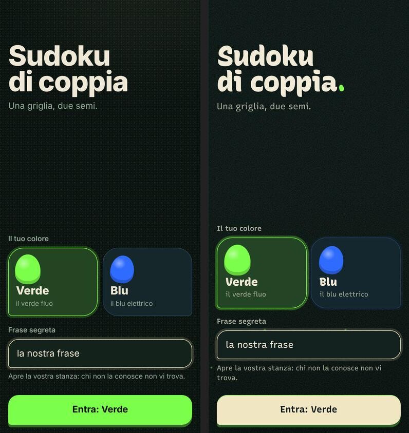

Home a 0 fiori (solo verde, il blu non c'è ancora): 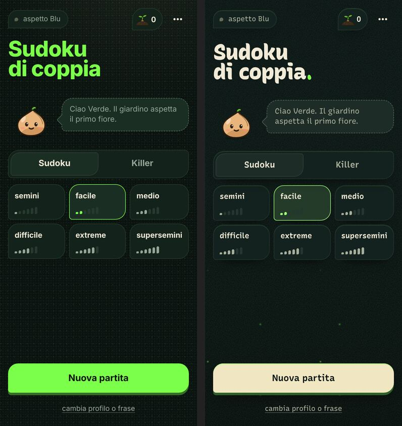

Home sbloccata (8 fiori): vedi sopra, `img/3-home-sbloccata.jpg`.

Partita, telefono, dopo un errore (prima: frase sopra le celle e banner sul cruscotto; dopo: fumetto al posto della barra, accanto a chi parla): 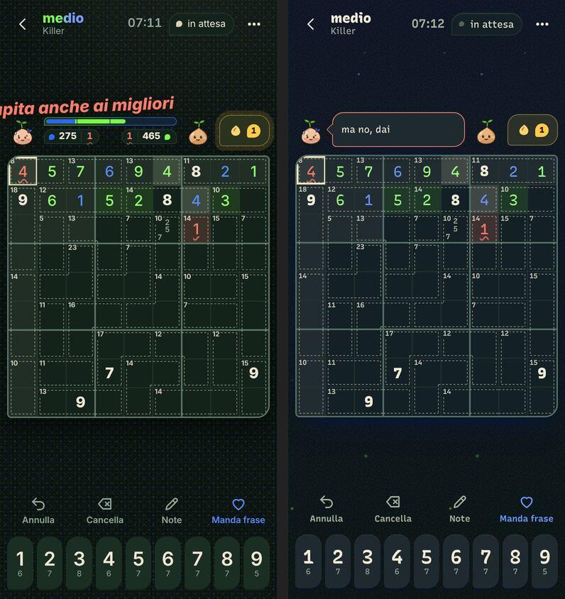

Partita a 3 fiori, solo Semino: 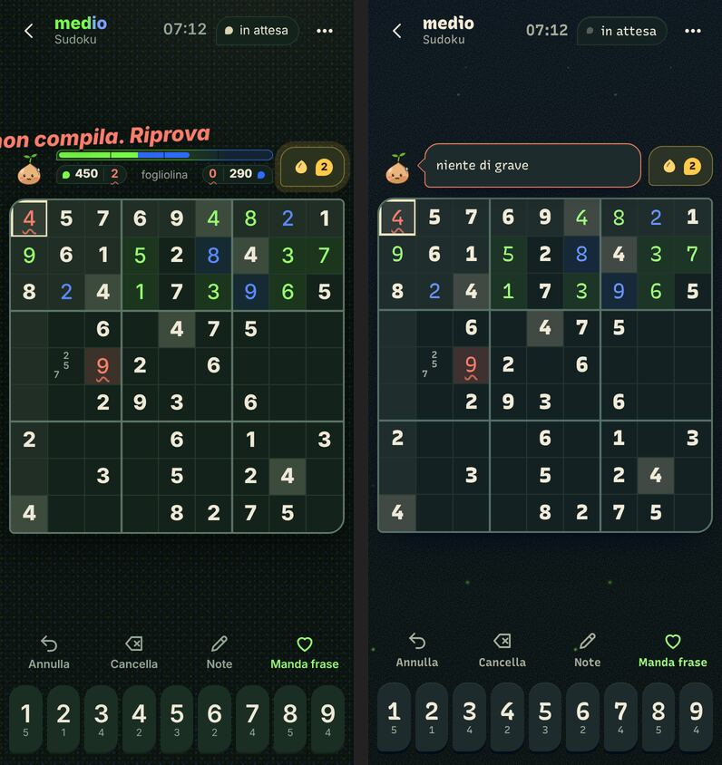

Partita, desktop: 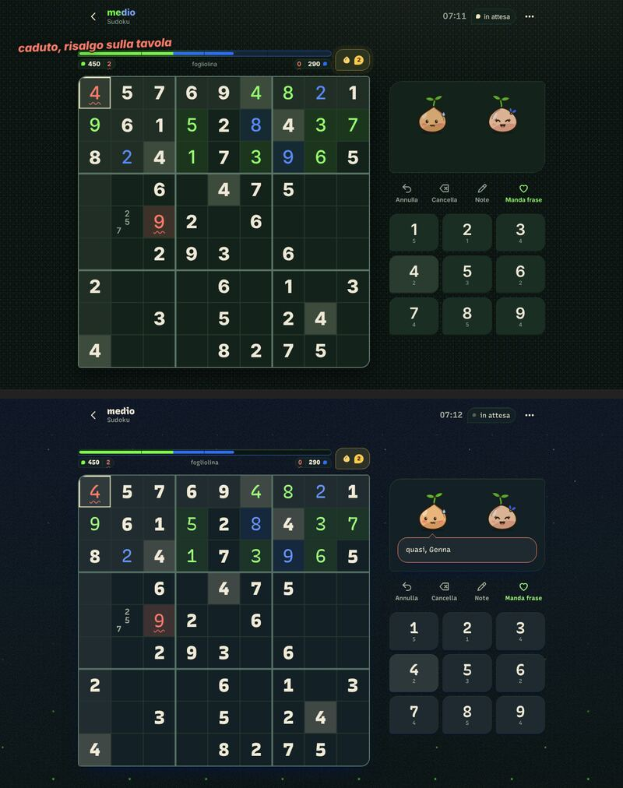

Frase mandata dal partner (dopo, sul telefono di chi la riceve): 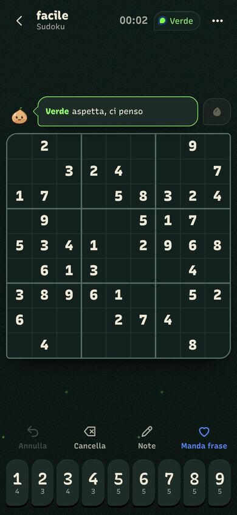

Giardino: 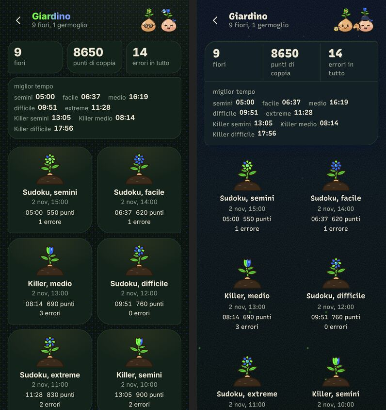

Giardino vuoto: 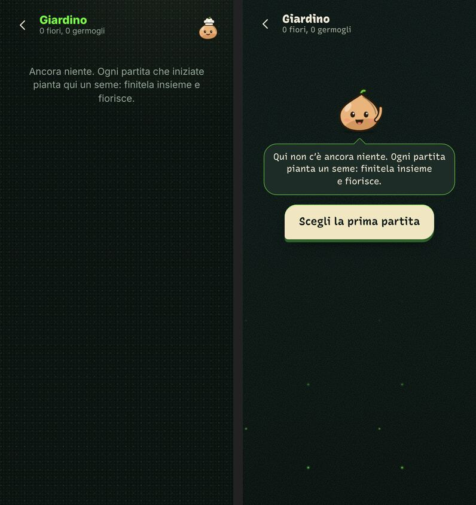

Vittoria: 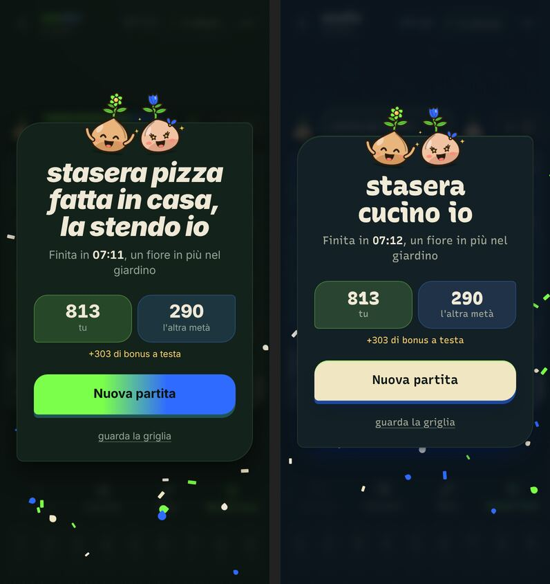

Menù: 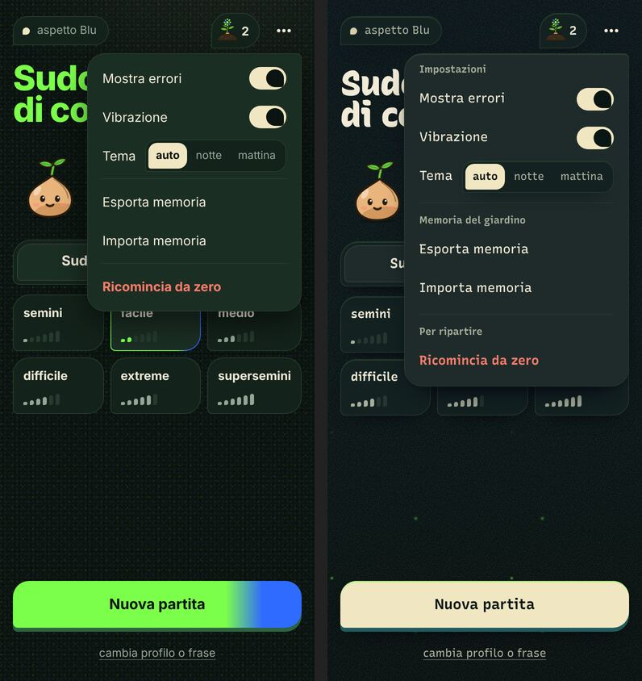

Mattina (tema chiaro, dopo): 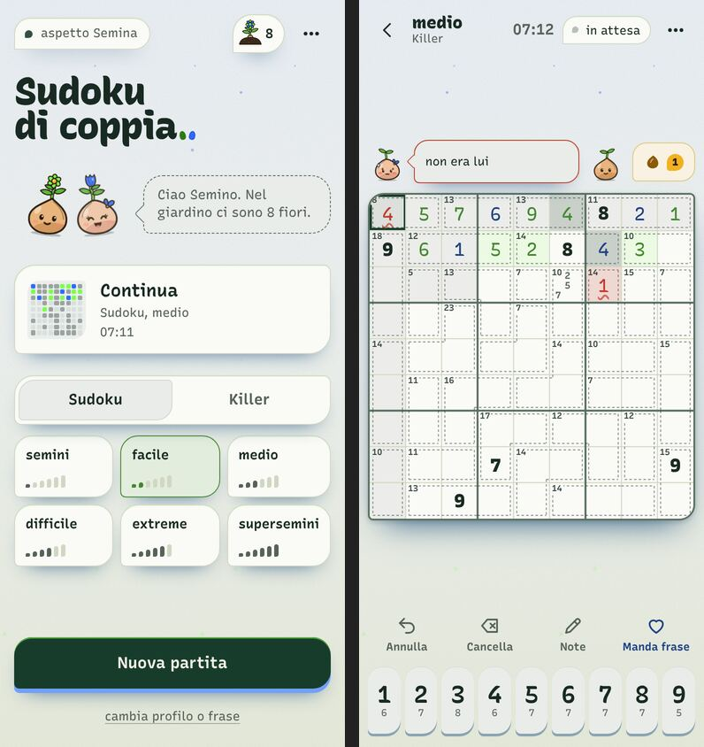

Sguardo verso le celle 0, 8, 80: 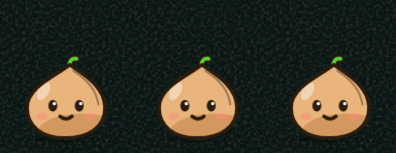

## 6. Rischi e cose da guardare dal vero

- Il fumetto su telefono copre la barra di crescita e i punti per ~3 s: i numeri restano leggibili nel pannello solo su desktop.
- Frasi lunghe vengono tagliate a due righe sul telefono (testo completo nel `title` e per i lettori di schermo).
- Lo sguardo usa la classe interna `.semino-occhi` di `Semino.tsx` (proprietà `translate`, separata dalle animazioni di battito): se il disegno cambia nome al gruppo, gli occhi smettono di seguire senza errori.
- Il blu dei numeri di mattina diventa un blu notte (contrasto prima dell'elettricità).
- La classe `toast` e `data-categoria` sul fumetto restano solo per compatibilità coi test a due client.
